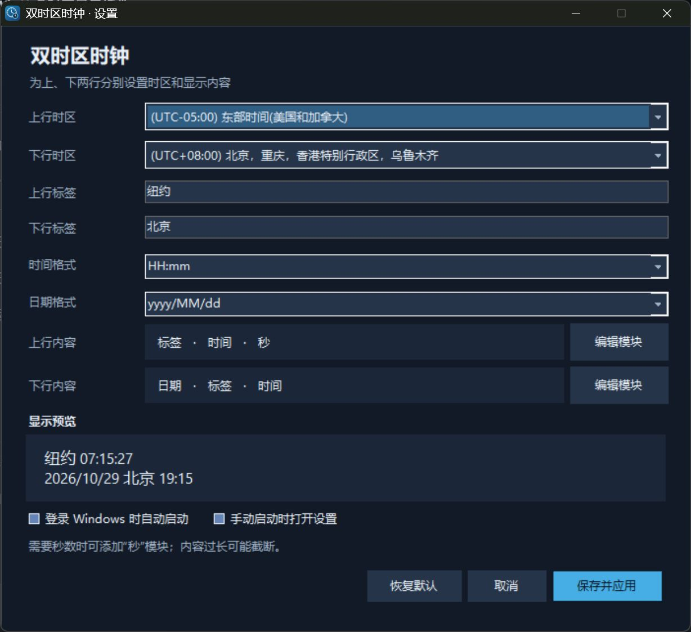
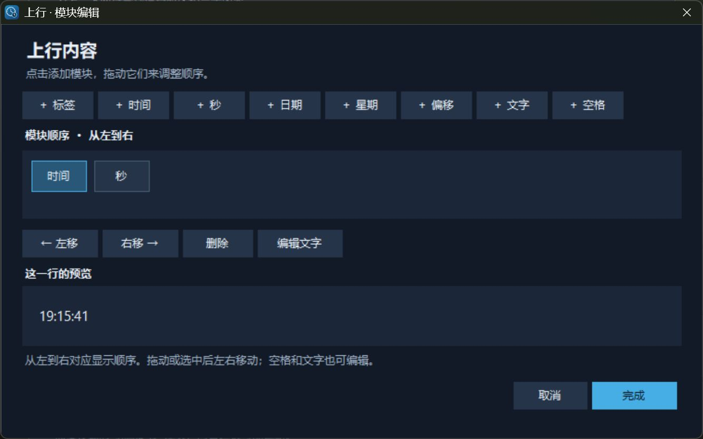

# 双时区任务栏时钟 · Dual Time Zone Taskbar Clock

在 Windows 11 原生任务栏时钟位置自定义两行内容，独立选择两个时区。单文件程序不需要 Windhawk；不会更改系统时区或系统文件。

> **兼容性限制：本版本只针对 Windows 11 x64 构建 26200.9711 的特定任务栏组件验证。** 程序会校验 `SystemTray.dll` 的 SHA-256、模块头和调用位置；组件不匹配时拒绝启用。Windows 更新或不同电脑可能需要重新适配，不能只靠更改版本号或跳过校验来保证安全。

## 安全风险与发布签名

<div style="color:#c00000; border:2px solid #c00000; padding:12px; margin:12px 0;">
<strong>⚠️ 报毒风险（请在运行前阅读）</strong><br>
本程序为了修改 Windows 原生任务栏时钟，会把自己的 DLL 注入 <code>explorer.exe</code>，并修改 <code>SystemTray.dll</code> 的时钟调用。这是有意的跨进程注入和 IAT Hook 行为，可能被 Microsoft Defender、火绒、360 或其他安全软件识别为木马、<code>Injector</code>、<code>HackTool</code> 或 <code>CreateRemoteThread</code> 行为。数字签名只能改善“未签名或来源未知”的信誉告警，不能保证消除这类行为告警。请不要为了运行本程序关闭杀毒软件或添加全局排除项；如果不能接受此风险，请不要运行本程序。
</div>

本程序不是普通的托盘时钟。为了保持 Windows 原生任务栏时钟的位置，控制程序会打开 `explorer.exe`，使用远程线程调用 `LoadLibraryW` 把项目自己的 `ClockNativeV7.dll` 加载进任务栏进程，然后由该 DLL 修改 `SystemTray.dll` 中已验证的时间格式化导入项；需要秒数时还会调整已验证的时钟调度调用。相关实现见 [`NativeTaskbarClock.cs`](src/NativeTaskbarClock.cs) 和 [`clock_hook.c`](src/clock_hook.c)。这是本项目有意采用的跨进程 DLL 注入和 IAT Hook 行为，可能被 Microsoft Defender 或其他安全软件报告为 `HackTool`、`Injector`、`CreateRemoteThread` 或木马类启发式检测。检测到这种行为并不自动证明程序含有窃密功能，但也不能把这类告警一概当成误报。

程序没有网络服务或远程更新逻辑；它会把内嵌的原生模块释放到 `%LOCALAPPDATA%\DualZoneTaskbarClock`，并且只有在用户勾选自启动时才写入当前用户的 `Run` 注册表项。退出时会尝试恢复 Hook；如果资源管理器仍持有旧模块，可能需要重启资源管理器或重新登录。不要为了运行本程序关闭 Defender、添加整个目录排除项或使用来源不明的“解锁版”。

GitHub Release 中的 EXE 必须使用可信发布者证书签名。默认运行 `build.ps1` 不会产生签名文件；公开发布时应先签名 `ClockNativeV7.dll`，再把它嵌入最终 EXE，最后签名 `TimeZoneClock.exe`，并在 Release 中公布 SHA-256、源码提交号和签名验证结果。自签名证书只适合本机测试，不能建立公共 SmartScreen 信誉。若安全软件仍将经过签名的构建报告为威胁，请保留检测名称、定义版本和 SHA-256，通过 [Microsoft Security Intelligence 文件提交页面](https://www.microsoft.com/en-us/wdsi/filesubmission?persona=HomeUser) 以软件开发者身份提交复核。

## 运行效果

**设置与显示预览**：示例中上行使用纽约时间，下行使用北京时间；两个时区和每一行的内容都可以更换。



**模块编辑器**：可以选择时间、秒、日期等模块并横向调整顺序。



截图中的显示内容可以自行调整；任务栏可用空间有限，过长内容可能被截断。

## 功能

- 上行和下行都可以从 Windows 提供的时区列表中选择，也都可以跟随系统时区。
- 根据各地区的夏令时规则转换时间；每行都可以显示对应时区的日期。
- 设置面板支持为两行分别选择时区、标签和模块，并调整时间及日期格式。
- 上行和下行分别提供模块编辑器，可添加、排序、删除标签、时间、秒、日期、星期、UTC 偏移、自定义文字及空格。
- 深色设置面板和专门设计的应用、通知区域图标。
- 可为当前用户启用登录 Windows 后自动启动；等待尚未加载的任务栏并重试。
- 程序在后台常驻，设置面板关闭后不必保持打开。

默认使用系统时区和中国时间，也可以换成例如纽约和东京；不改变 Windows 的系统时区。任务栏仍为两行。添加秒模块或在时间格式中使用秒后，时钟按约一秒刷新；不显示秒时继续使用 Windows 的原有刷新节奏。

## 从源码构建

需要 Windows x64、.NET Framework 4.x 的 64 位 C# 编译器，以及 [Zig](https://ziglang.org/download/)（已用 Zig 0.15.2 构建）。运行独立测试还需要 Python 3。

在项目根目录打开 PowerShell：

```powershell
.\build.ps1
```

如果 PowerShell 阻止本地脚本运行，可以仅针对这次构建执行 `powershell.exe -NoProfile -ExecutionPolicy Bypass -File .\build.ps1`。

如果 `zig.exe` 不在 PATH，可以指定它的路径：

```powershell
.\build.ps1 -ZigPath 'C:\tools\zig\zig.exe'
```

如果当前用户证书存储中有带私钥的发布证书，可以在构建时签名原生模块和最终 EXE。`signtool.exe` 可以通过 PATH 或 `-SignToolPath` 指定；证书指纹只用于定位证书，不要把私钥或密码提交到仓库：

```powershell
.\build.ps1 `
    -SignToolPath 'C:\Program Files (x86)\Windows Kits\10\bin\x64\signtool.exe' `
    -SigningCertificateThumbprint '证书 SHA-1 指纹' `
    -RequireSignature
```

不传 `-SigningCertificateThumbprint` 时，脚本会明确提示输出未签名；传入 `-RequireSignature` 时，如果找不到 `signtool.exe`、证书或时间戳服务，构建会直接失败。构建完成后可用下面的命令检查最终文件：

```powershell
Get-AuthenticodeSignature .\dist\single\TimeZoneClock.exe |
    Format-List Status,SignerCertificate
Get-FileHash .\dist\single\TimeZoneClock.exe -Algorithm SHA256
```

生成的独立程序为 `dist\single\TimeZoneClock.exe`，复制这个 EXE 即可运行。原生模块嵌入在 EXE 中，首次启动时自动解压到当前用户的本地应用数据目录；配置也保存在该目录，不要求程序所在文件夹可写。

要运行独立测试：

```powershell
.\build.ps1 -Test
```

也可以同时传入 `-ZigPath` 和 `-PythonPath`；测试默认使用 Windows Python 启动器 `py -3`，如果没有安装启动器，请用 `-PythonPath` 指定 Python 3 可执行文件。测试包含格式预览、启动选项、自动重试以及在独立测试进程中安装和恢复 DLL 钩子；测试不会对 Explorer 或真实的登录启动项操作。真实登录流程仍需在目标机器自行验证。

## 使用

1. 如有旧版正在运行，先从通知区域右键旧图标，选择“退出并恢复原时钟”。
2. 双击 `dist\single\TimeZoneClock.exe`。第一次运行会打开设置面板；之后可以双击通知区域的图标或再次运行程序打开设置。
3. 分别选择两个时区，设置标签、两行模板和顺序，点击“保存并应用”。Windows 任务栏可能到下一分钟才显示更新后的格式。
4. 如需自启动，勾选“登录 Windows 时自动启动”，然后保存。要取消自启动，取消勾选并保存。移动程序前应先关闭自启动，移动后重新启用，以便更新路径。旧版的本程序启动项会在保存新版设置时迁移到新版程序。
5. 退出时，右键通知区域的时钟图标，选择“退出并恢复原时钟”。关闭设置面板不会退出后台程序。

点击上行或下行旁的“编辑模块”打开编辑器。模块按从左到右横向排列，可以拖动调整顺序，也可以选中后点击“左移”“右移”或“删除”，预览随之更新。标签文字为空时，主界面和编辑器都不显示旧的空标签；如需添加标签，点击“＋ 标签”填写文字即可。添加模块不会自动插入空格，需要时可点击“＋ 空格”。需要 `18:44:05` 时，先添加时间再添加秒，相邻的时间与秒模块会自动用冒号连接。确认后回到设置面板，再点击“保存并应用”。

模块的内部模板会继续保存，旧格式可以保留；需要时可从托盘菜单打开配置文件作高级编辑。`%label%` 是标签，`%time%` 是时间，`%second%` 是两位秒数，`%date%` 是日期，`%weekday%` 是星期，`%offset%` 是该行时区相对 UTC 的偏移，`%%` 显示百分号。内容过长可能被任务栏截断；时间和日期格式使用 Windows 的格式规则。

如果更换了 DLL 后提示已有不同版本的时钟模块，先退出本程序，再重启 Windows 资源管理器或重新登录，让旧 DLL 从进程中卸载。

## 工作原理与限制

控制程序将项目自己的 DLL 加载进 `explorer.exe`，在经过版本和调用位置检查后替换 `SystemTray.dll` 的时间格式化导入项。需要秒数时，也会调整已验证的时钟调度调用，使它按约一秒刷新；不反复写注册表，也不修改 Windows 的秒数显示设置。退出或控制进程结束时会尝试恢复调用；为避免在线程仍可能使用 DLL 时强制卸载，DLL 可以保持加载但不再修改时钟，直到资源管理器退出。由于依赖未公开的任务栏内部细节，系统更新可能使它停止工作，也可能与其他时钟修改工具冲突。

启用登录自启动时，程序为当前用户写入 Windows `Run` 注册表项；配置和自动提取的 DLL 保存在 `%LOCALAPPDATA%\DualZoneTaskbarClock` 下。它不需要网络服务。

## 致谢与许可证

Windows 任务栏时钟相关研究参考了 [m417z 的 Windhawk Taskbar Clock Customization](https://github.com/ramensoftware/windhawk-mods/blob/main/mods/taskbar-clock-customization.wh.cpp)，该项目以 GPLv3 发布；本项目运行时不依赖 Windhawk。

本项目以 [GNU General Public License v3.0](LICENSE) 发布。
